
Side-Channel Countermeasures for Adam’s Bridge Accelerator

Version 3.0

**Note:** This document will be updated soon and will include the countermeasure implementation details.

See NIST FIPS 204 document for the pseudo codes and symbols. 

# Threat Model for Securing Adams Bridge Against Side-Channel Attacks

## Introduction

In this threat model, the document outlines the potential vulnerabilities and the measures taken to secure the hardware implementation of the Crystal Dilithium post-quantum cryptographic algorithm against side-channel attacks. The document distinguishes between profiled and non-profiled attacks, identify the private and secret key values, and separate timing side-channel attacks from other physical attacks such as power, EM, and acoustic attacks. This model specifically addresses the operations involved in key generation and signature generation, excluding the verification routine which does not involve secret data processing.

## Attack Vectors

### Profiled Attacks

**Definition**: Attacks where the adversary has prior knowledge or can build a profile of the target device’s behavior under various conditions. This attack has two phases: profiling and attacking. First, the attacker has physical access to the identical device and can configure it with known keys to capture side-channel traces. Therefore, the adversary can capture multiple measurements to create templates corresponding to known keys or intermediate values. 

Second, it is assumed that the adversary has sufficient knowledge about the details of the target implementation, i.e., the adversary downloads and inspects the publicly available RTL. The adversary captures one or multiple similar traces that are obtained from the device while it is executing the same inputs. The captured trace(s) go through a matching process where they are compared with pre-constructed templates, returning the label of the closest template.

**Targets**: Extraction of secret keys or private values by comparing the observed behavior with pre-constructed profiles.

### Non-Profiled Attacks

**Definition**: Attacks where the adversary does not have prior knowledge or profiles and relies solely on observed behavior during cryptographic operations. The example is Correlation Power Analysis (CPA). The attacker collects many side-channel traces during the execution of cryptographic operations. These traces are then statistically analyzed to find correlations between the side-channel measurement and hypothesized intermediate values, allowing the attacker to deduce the secret keys or private values. These attacks ideally work when the targeted device is configured with only a fixed secret key, with only one series of non-adaptive observations on operations using that single key.

Targets: Direct extraction of private or secret values from real-time observations without prior profiling. This strategy can be particularly effective against operations with data-dependent power consumption or electromagnetic emissions.

**Note**: *Non-profiled attacks are considered more powerful than profiled attacks since they can eliminate the effect of noise. The success rate is a matter of the number of collected traces rather than solely relying on platform conditions, and therefore their countermeasures are more limited and expensive*

**Note**: *This threat model covers the side-channel attack vectors for the deterministic version of Crystal Dilithium post-quantum cryptographic algorithm. Since the deterministic version covers all profiled and non-profiled attack vectors of hedged, this threat model covers superset of the hedged version of Crystal Dilithium post-quantum cryptographic algorithm. For simplicity, this document illustrates the main difference between hedged and deterministic version of the algorithm as given by: the hedged version generates Ro prime with a fresh randomness for each signature. As a result, the private intermediate values derived from this randomness are not considered for non-profiled attack.*

## Private and Secret Values

### Secret Keys

All secret keys are considered private and must be protected from both profiled and non-profiled attacks.

### Private Values

Private values include intermediate variables that can provide information about the secret keys if recovered. Although private values are not always secret, their recovery can reveal significant information about the secret keys.

## Threat Coverage

### Physical Side-Channel Attacks

**Types Covered:** Power analysis, electromagnetic (EM) analysis, and acoustic analysis.

**Scope:** All operations involved in key generation and signature generation.

**Countermeasures:** Combined masking and shuffling techniques to obscure power and EM signatures, and careful design to mitigate acoustic leakage.

### Timing Side-Channel Attacks

**Scope**: All operations in key generation and signature generation.

**Objective**: Ensure no variation in timing of any externally visible events that could reveal private values.

**Approach**: Implement constant-time execution for operations involving private values, while allowing non-constant time execution for other operations that do not involve private values.

## Key Generation

### Timing Side-Channel Attack Mitigation

The key generation implementation does not have any operations whose execution time varies based on private values. Ensures that no information about private values is leaked through timing variations.

### Physical Side-Channel Attack Mitigation

The key generation operation does not have a non-profiled attack vector since its nature is inherently secure against CPA-style attacks. This is because non-profiled attacks require multiple traces captured while constant secret or private values are being processed. Additionally, the attacker needs to either control or observe different inputs or outputs such that the side-channel measurement can be differentiated. Although key generation can be executed multiple times to satisfy the first condition of CPA, the second condition is not satisfied because each execution works with the same inputs and generates the same output. If the attacker needs to satisfy the second condition and feed the key generation with different inputs, this condition dissatisfies the first condition of CPA since the secret changes for each different input.

## Signature Generation

### Timing Side-Channel Attack Mitigation

Signature generation involves several steps where private values are processed. To mitigate timing side-channel attacks, we focus on ensuring that the execution time of these operations does not vary based on private values. We have timing variation only in signature validity checks. Validity check mechanism’s timing side-channel analysis is given by:

#### *Validity Checks:*

**First Validity Check**: This check involves conditions based on z and r0 (see FIPS 204:Algorithm 2:21-23). These checks are performed to ensure that the time taken does not vary based on the values of z and r0. If a condition fails, the signature routine iterates again. In our case, the implementation does not return a rejected signature and does not write the rejected signature to any location accessible by firmware.

The threat model assumes that having information about the result of the first validity check reveals partial information about the boundaries of r0. Specifically, it indicates whether r0 is less than gamma2 \- beta. Although r0 is a private polynomial, knowing partial information about r0 does not reveal the secret. This is because r0 is generated through an operation involving subtraction and multiplication.

The operation consists of one secret polynomial undergoing subtraction with a polynomial that is the product of a secret and public information. This multiplication blinds the public information, making the product a private value. Consequently, r0 is a product of two private values. Even though knowing r0 would require solving an NP-hard problem to recover the secret, the execution time of the validity check only reveals partial information about r0.

**Second Validity Check:** The second validity check also involves two conditions (see FIPS 204:Algorithm 2:27). The second condition, when true, is public. The first condition involves ct0, which is a blind value due to the multiplication. However, knowing the boundaries of this product can reveal information about the private value.

To prevent leaking coefficient-wise information about ct0, our design performs a full check of ct0 before returning the validity check result, rather than returning immediately after the first rejected coefficient. This approach ensures that the attacker cannot gain detailed coefficient-wise information about ct0. Instead, the attacker only knows that at least one coefficient of ct0 is less than gamma2.

By performing a full check, the design prevents timing variations that could reveal partial information about the private value ct0. The attacker is forced to solve the algebraic equation involving ct0 with the limited information that at least one coefficient is less than gamma2, making it significantly harder to extract useful private information.

### Physical Side-Channel Attack Mitigation

The threat model assumes that signature generation is vulnerable to non-profiled attack vectors. This is because an attacker can sign multiple different messages with a constant secret, allowing them to perform side-channel analysis. Therefore, the document focuses on the operations where a known message (c) or a known matrix (A) interacts directly and purely with secret or private values:

Identified Vulnerable Operations:

Point-wise Multiplication: Operations involving cs1, cs2, ct0, and Ay.

To mitigate these vulnerabilities, the following strategies are employed:

* Masking Countermeasures: Applied specifically to Point-wise Multiplication (PWM) operations. These countermeasures ensure that the output values are blinded, as the public value c is multiplied with secrets such as t0, s1, and s2. In addition to the point-wise multiplication, the first stage of inverse-NTT is also masked. 
* Special Case for A and y Multiplication: Although A is publicly known, the attacker cannot update A without updating the secret keys. Consequently, the multiplication of A with y is not subject to CPAs if A remains constant for given secret key. Therefore, Version 1.0 does not employ masking countermeasures for the A·y operation. However, this operation will be masked in future versions.
* Shuffling Techniques: Employed for other operations that are required before or after PWM multiplication, including NTT, pointwise addition, and subtraction. Shuffling helps to randomize the order of these operations, further obscuring any potential side-channel leakage. Additionally, the norm check operation is also protected using shuffling, as it can reveal information about the rejection process during signature generation. By randomizing the coefficient order, shuffling mitigates the risk of identifying which specific coefficient causes the signature rejection.

**Note**: Masking and shuffling require randomness entropy, which is obtained using PRNGs assumed to be anti-tampered.

### Operations Protected with Masking

Point-wise multiplication and the first state of inverse NTT.

### Operations Protected with Hiding

NTT, point-wise addition and point-wise subtraction.

## ML-KEM Decapsulation Usage Model

The ML-KEM side-channel countermeasures assume the **ephemeral decapsulation-key usage model** defined in [AdamsBridge_MLKEM.md — Usage Model Restriction: Decapsulation Key Reuse](./AdamsBridge_MLKEM.md#usage-model-restriction-decapsulation-key-reuse).

Multi-query chosen-ciphertext side-channel attacks need many decapsulations under the same decapsulation key. These include plaintext-checking and decryption-failure oracle attacks on the Fujisaki–Okamoto re-encryption and comparison. Such attacks are **outside the threat model** covered by this document.

They are mitigated by the usage model, which the integrator (firmware or protocol layer) enforces:
- single-use decapsulation keys; or
- bounded reuse with key rotation when a decapsulation fails.

Consistent with FIPS 203 implicit rejection, the hardware neither tracks key reuse nor exposes a decapsulation-failure indication.

# Attack Vectors

| Attack Type | Definition & Assumptions | Targets | Countermeasures |
| :---- | :---- | :---- | :---- |
| Profiled Attacks | Adversary has prior knowledge or can build a profile of the target device’s behavior. The attack has profiling and attacking phases. | Extraction of secret keys or private values by comparing observed behavior with pre-constructed profiles. | Masking and hiding techniques. |
| Non-Profiled Attacks | Adversary relies solely on observed behavior during cryptographic operations (e.g., CPA). | Direct extraction of private or secret values from real-time observations without prior profiling. | Masking countermeasures; use of PRGNs for randomness entropy. |

# Private and Secret Values

| Value Type | Description | Protection Requirements |
| :---- | :---- | :---- |
| Secret Keys | All secret keys are considered private and must be protected from non-profiled attacks. | Must be protected from any form of leakage; ensure no direct correlation with physical measurements. |
| Private Values | Intermediate variables that can reveal significant information about secret keys if recovered. | Protect against non-profiled attacks; apply masking and shuffling. |

# Threat Coverage

| Attack Type | Scope | Countermeasures |
| :---- | :---- | :---- |
| Physical Side-Channel Attacks | Power analysis, electromagnetic (EM) analysis, and acoustic analysis for all key generation and signature generation operations. | Combined masking and shuffling techniques; careful design to mitigate acoustic leakage. |
| Timing Side-Channel Attacks | All operations in key generation and signature generation. | Constant-time execution for operations involving private values; ensure no timing variations. |

## Legacy Empirical Validation (v1.0)

Version 1.0 presents TVLA results only for the case where the shuffling countermeasure is enabled. The results show that the shuffling countermeasure reduces the t-score by 100x compared to the unprotected design. However, leakage is still observed after 55K captured traces.

### Experiment Setup:
- **Target Physical Device**: CW310 Bergen Board with Kintex K410T FPGA, executing the hardware design for side-channel evaluation. The FPGA board has a designated SMA port that provides the power drop across a shunt resistor.
- **Oscilloscope**: PicoScope 6428E-D, capable of capturing up to 10 GS/s.
- **FPGA Operating Frequency**: 10 MHz.
- **Oscilloscope Sampling Frequency**: 156 MHz.

<!-- **Figure 1**: NTT and Point-wise multiplication TVLA results for 54,000 traces, showing leakage after 55,000 traces.

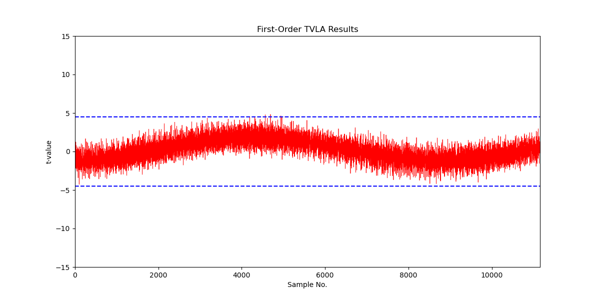

Although Version 1.0 includes masking countermeasures, this report does not present TVLA results for masking countermeasures. These results will be provided in future releases. -->

# Side-Channel Analysis (SCA) — TVLA Results for ML-KEM & ML-DSA

## Adams Bridge v3.0 Evaluation

### Experimental Setup

Measurements are performed on the **SCA-specific CW310 Bergen board**, equipped with a **Kintex-7 XC7K410T FPGA**. This board variant facilitates high-fidelity side-channel measurements and exposes the voltage drop across an onboard shunt resistor through a dedicated SMA connector. The FPGA operates at **10 MHz**, improving cycle-level visibility and reducing temporal overlap between consecutive operations. Power traces are captured using a **PicoScope 6424E** oscilloscope at **156.25 MS/s**.

| Parameter | Configuration |
| --- | --- |
| Target | SCA-specific CW310 Bergen |
| FPGA | Xilinx Kintex-7 XC7K410T |
| Power measurement | Onboard shunt resistor via dedicated SMA connector |
| Oscilloscope | PicoScope 6424E |
| FPGA frequency | 10 MHz |
| Sampling rate | 156.25 MS/s |
| Statistical method | Fixed-versus-random, first-order Welch's t-test |
| Conventional threshold | Absolute t-score of 4.5 |
| Unprotected trace count | 100,000 |
| Protected trace count | 1,000,000 |

Fixed-versus-random TVLA compares two populations of measured traces acquired with fixed and randomized test values. A t-score exceeding either +4.5 or −4.5 is treated as a potential leakage indication requiring examination. Passing this threshold-based screening means only that no statistically significant first-order difference was detected in the measured region under the tested conditions. The test should not be interpreted as proof of cryptographic security.

### Evaluated Configurations

**Unprotected baseline:** Masking, shuffling, and the pseudorandom number generator (PRNG) are disabled. This configuration establishes whether the evaluated datapath exhibits detectable first-order leakage.

**Protected implementation:** Masking and shuffling are enabled, with randomness provided by the on-chip PRNG. The protected evaluation covers NTT, INTT, PWM, PWA, and KECCAK operations for ML-DSA and includes corresponding protected arithmetic-operation figures for ML-KEM.

The protected ML-DSA flow additionally uses two independently shuffled NTT engines to process the shares. The flow-level experiment examines whether leakage appears at operation boundaries, during recombination and norm checking, or at signature encoding.

### Unprotected ML-DSA Baseline

The unprotected ML-DSA implementation is evaluated using **100,000 power traces**. With masking, shuffling, and PRNG disabled, the evaluated arithmetic operations exhibit t-scores substantially beyond the ±4.5 threshold. NTT shows repeated leakage peaks across execution; INTT exhibits pronounced positive and negative excursions; and PWM and PWA reach t-scores of approximately **300**. The unprotected KECCAK measurement also exhibits statistically significant first-order differences.

| Operation | Observation | Traces |
| --- | --- | ---: |
| NTT | Repeated statistically significant leakage peaks | 100,000 |
| INTT | Pronounced positive and negative threshold crossings | 100,000 |
| PWM | Large excursions, approximately 300 in magnitude | 100,000 |
| PWA | Large excursions, approximately 300 in magnitude | 100,000 |
| KECCAK | Statistically significant first-order differences | 100,000 |

#### NTT — Unprotected

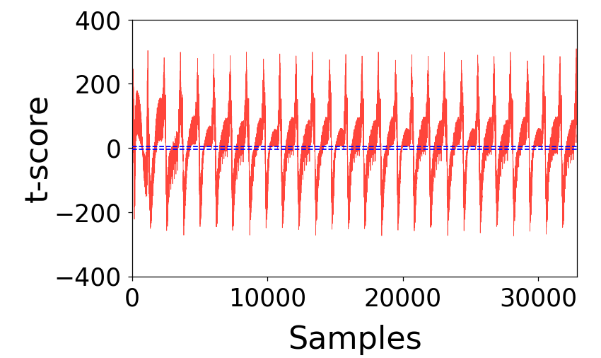

**Figure 1 — Unprotected ML-DSA NTT.** Repeated positive and negative excursions exceed the ±4.5 thresholds throughout the transform, indicating statistically significant first-order differences in the unprotected NTT datapath.

#### INTT — Unprotected

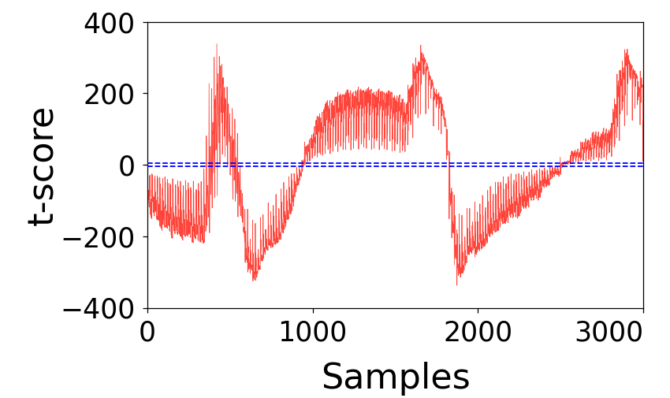

**Figure 2 — Unprotected ML-DSA INTT.** Pronounced positive and negative threshold crossings show data-dependent power behavior during the unprotected inverse transform.

#### PWM — Unprotected

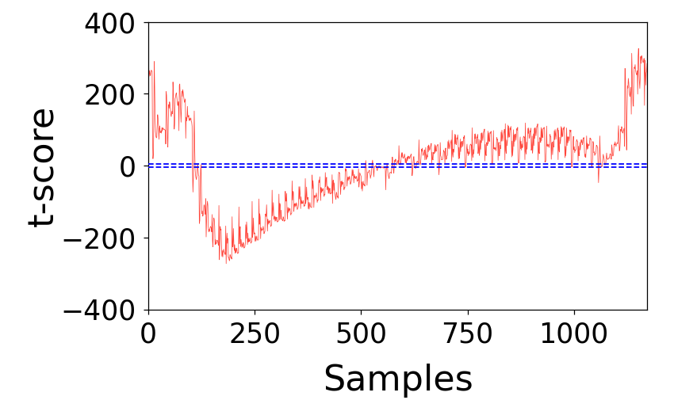

**Figure 3 — Unprotected ML-DSA PWM.** Large excursions, with t-score magnitudes approaching 300, indicate strong first-order differences in the point-wise multiplication measurement window.

#### PWA — Unprotected

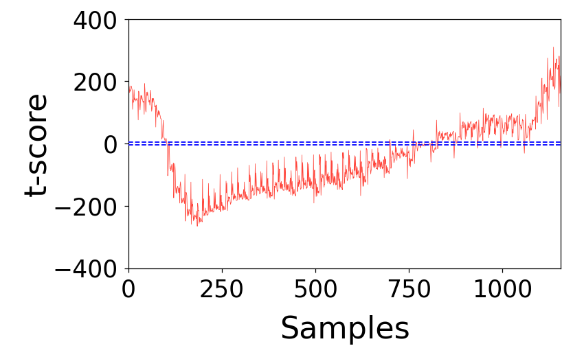

**Figure 4 — Unprotected ML-DSA PWA.** T-score magnitudes approaching 300 indicate substantial first-order differences during unprotected point-wise addition.

#### KECCAK — Unprotected

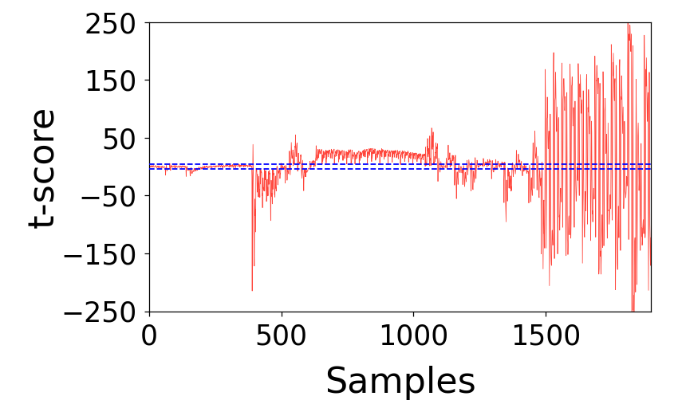

**Figure 5 — Unprotected ML-DSA KECCAK.** First-order TVLA results using 100,000 power traces. Statistically significant threshold crossings are observed in the unprotected KECCAK measurement window, indicating data-dependent power consumption.

**Figures 1–5.** First-order TVLA results for the unprotected ML-DSA NTT, INTT, PWM, PWA, and KECCAK operations using 100,000 power traces. Dashed blue lines mark ±4.5. All five evaluated measurement windows exhibit statistically significant first-order differences.

### Protected ML-DSA Evaluation

The protected ML-DSA implementation is evaluated with **masking and shuffling enabled** and randomness supplied by the on-chip PRNG. **One million power traces** are analyzed for each evaluated operation.

For NTT, INTT, PWM, and PWA, the reported t-scores remain within ±4.5 throughout the evaluated execution windows. Similarly, no statistically significant first-order leakage is detected during the protected KECCAK computation. However, threshold crossings are observed during the initial data-loading phase, before the KECCAK computation begins.

Thus, **no statistically significant first-order leakage is detected in the evaluated protected computation regions under the tested conditions**, despite using ten times as many traces as the unprotected baseline.

| Operation | Countermeasures | Traces | Reported outcome |
| --- | --- | ---: | --- |
| NTT | Masking + shuffling | 1,000,000 | No detected first-order leakage in evaluated window |
| INTT | Masking + shuffling | 1,000,000 | No detected first-order leakage in evaluated window |
| PWM | Masking + shuffling | 1,000,000 | No detected first-order leakage in evaluated window |
| PWA | Masking + shuffling | 1,000,000 | No detected first-order leakage in evaluated window |
| KECCAK | Masking + shuffling | 1,000,000 | No detected first-order leakage during computation; threshold crossings during initial data loading |

#### NTT — Protected

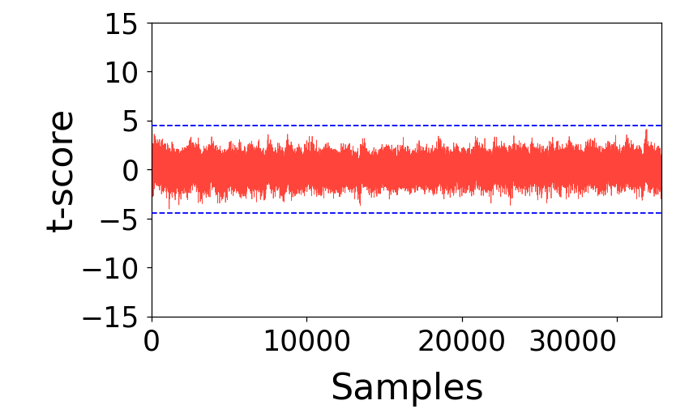

**Figure 6 — Protected ML-DSA NTT.** With masking and shuffling enabled, the t-scores remain within ±4.5 across the measured NTT window at one million traces, unlike the repeated peaks in the unprotected baseline.

#### INTT — Protected

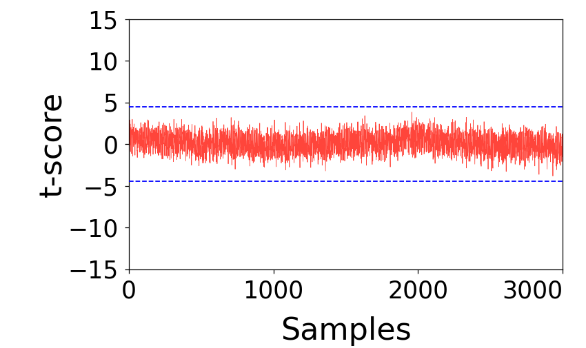

**Figure 7 — Protected ML-DSA INTT.** The inverse transform remains within the first-order TVLA thresholds across the evaluated window using one million traces, in contrast to the unprotected INTT excursions.

#### PWM — Protected

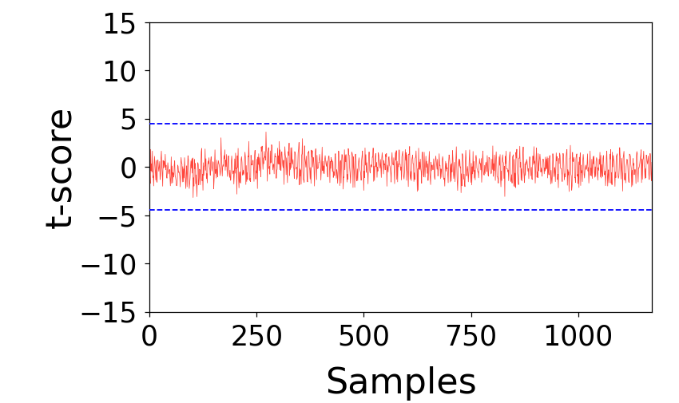

**Figure 8 — Protected ML-DSA PWM.** No threshold crossing is detected in the evaluated protected multiplication window, compared with the strong unprotected PWM leakage.

#### PWA — Protected

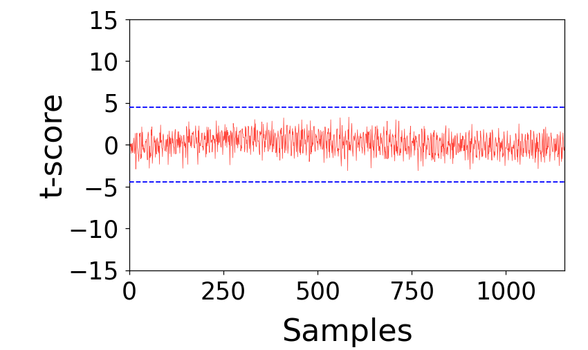

**Figure 9 — Protected ML-DSA PWA.** The protected addition window remains within ±4.5 using one million traces, contrasting with the strong unprotected PWA leakage.

#### KECCAK — Protected

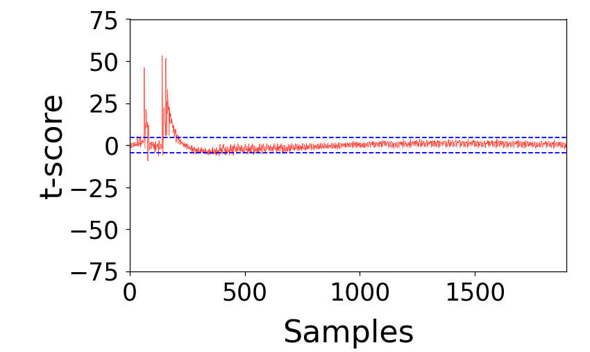

**Figure 10 — Protected ML-DSA KECCAK.** First-order TVLA results using one million power traces. No statistically significant first-order leakage is observed during the protected KECCAK computation. Threshold crossings are limited to the initial data-loading phase, where input data is read from memory.

The observed initial data-loading leakage is outside the scope of the targeted secret-key recovery attacks under the considered non-profiling side-channel threat model. Our analysis did not establish any exploitable secret-key leakage associated with these observations. Accordingly, the initial data-loading activity is distinguished from leakage within the protected KECCAK computation.

**Figures 6–10.** First-order TVLA results for the protected ML-DSA NTT, INTT, PWM, PWA, and KECCAK operations using one million power traces. Dashed blue lines indicate ±4.5. No threshold crossings are detected within the evaluated protected computation regions. For KECCAK, the observed threshold crossings occur during initial data loading rather than during the cryptographic computation.

### Protected ML-KEM Evaluation

The version 3.0 evaluation also includes protected-operation TVLA figures for **ML-KEM NTT, INTT, PWM, and PWA**. These measurements complement the ML-DSA results and extend coverage to the corresponding ML-KEM arithmetic datapath. The supplied protected ML-KEM plots are reproduced below. The same evaluation methodology and first-order threshold interpretation apply.

#### NTT — Protected

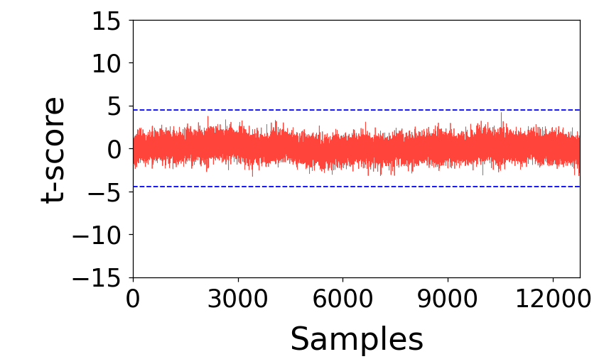

**Figure 11 — Protected ML-KEM NTT.** The plotted first-order t-scores remain within ±4.5 in the evaluated NTT window; this is an operation-level result rather than a full ML-KEM decapsulation assessment.

#### INTT — Protected

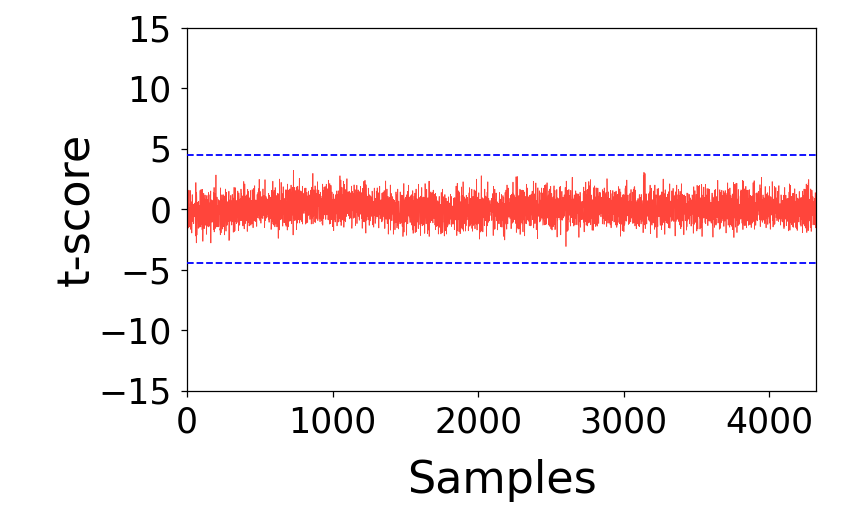

**Figure 12 — Protected ML-KEM INTT.** No statistically significant first-order threshold crossing is observed in the measured inverse-transform window.

#### PWM — Protected

**Figure 13 — Protected ML-KEM PWM.** The measured point-wise multiplication t-scores remain within the ±4.5 screening bounds under the evaluated protected configuration.

#### PWA — Protected

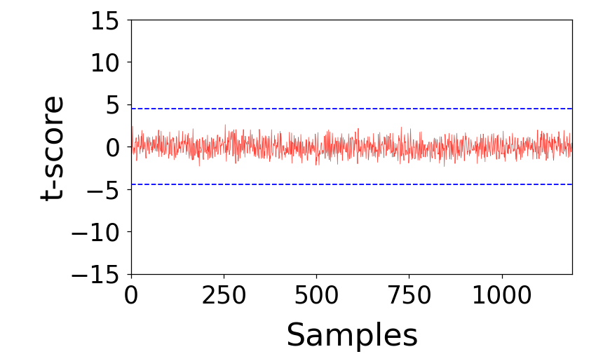

**Figure 14 — Protected ML-KEM PWA.** The measured point-wise addition t-scores remain within the first-order TVLA screening bounds in the displayed window.

**Figures 11–14.** First-order TVLA plots for protected ML-KEM NTT, INTT, PWM, and PWA operations. Dashed blue lines indicate the ±4.5 screening thresholds. No statistically significant first-order leakage is detected within the evaluated protected arithmetic-operation windows.

### ML-DSA NTT-Domain Flow Evaluation

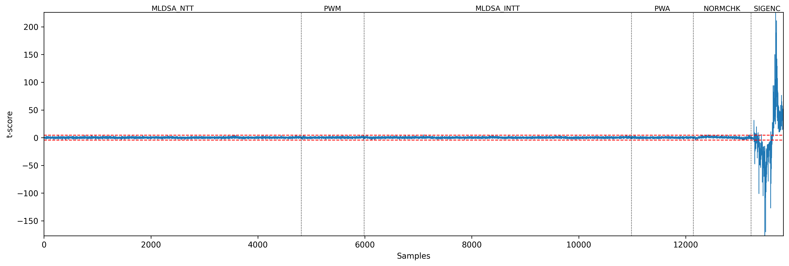

**Figure 15 — ML-DSA NTT-Domain Flow Evaluation.** First-order TVLA results for the complete NTT-domain flow of the protected ML-DSA implementation, comprising NTT, PWM, INTT, PWA, the norm check (NORMCHK), and signature encoding (SIGENC), using one million power traces. The red dashed lines indicate the statistical thresholds of +4.5 and −4.5. The excursions during SIGENC correspond to the encoding of the public signature component z, which differs between the fixed and random input sets by construction.

During NTT, PWM, INTT, and PWA, the two shares are processed using two independently shuffled NTT engines. The reported t-scores remain within ±4.5 throughout these protected regions. During the norm check, which operates on recombined coefficients of **z**, t-scores remain close to the screening thresholds.

Significant excursions are reported during **SIGENC**, where the recombined signature component **z** is encoded and output. Because **z** is part of the public signature, and is fixed in one TVLA population and random in the other, data-dependent power differences during its public encoding are expected. These differences must be interpreted in the context of the public output rather than automatically attributed to secret-key leakage. This distinction does not, by itself, prove that no additional secret-dependent information is present.

| Flow region | Reported observation | Interpretation |
| --- | --- | --- |
| NTT of shares | Within ±4.5 | No detected first-order difference in evaluated region |
| PWM | Within ±4.5 | No detected first-order difference in evaluated region |
| INTT | Within ±4.5 | No detected first-order difference in evaluated region |
| PWA | Within ±4.5 | No detected first-order difference in evaluated region |
| Norm check on recombined z | Close to thresholds | Boundary region requiring contextual interpretation |
| SIGENC | Significant excursions | Expected public-output-dependent differences from encoding z |

### Results Summary

| Algorithm | Configuration | Evaluated region | Traces | Observation |
| --- | --- | --- | ---: | --- |
| ML-DSA | Unprotected | NTT | 100,000 | First-order leakage detected |
| ML-DSA | Unprotected | INTT | 100,000 | First-order leakage detected |
| ML-DSA | Unprotected | PWM | 100,000 | First-order leakage detected |
| ML-DSA | Unprotected | PWA | 100,000 | First-order leakage detected |
| ML-DSA | Unprotected | KECCAK | 100,000 | First-order differences detected |
| ML-DSA | Masked + shuffled | NTT | 1,000,000 | No detected first-order leakage |
| ML-DSA | Masked + shuffled | INTT | 1,000,000 | No detected first-order leakage |
| ML-DSA | Masked + shuffled | PWM | 1,000,000 | No detected first-order leakage |
| ML-DSA | Masked + shuffled | PWA | 1,000,000 | No detected first-order leakage |
| ML-DSA | Masked + shuffled | KECCAK | 1,000,000 | No detected leakage during computation; initial data-loading threshold crossings |
| ML-KEM | Masked + shuffled | NTT | 1,000,000 | No detected first-order leakage |
| ML-KEM | Masked + shuffled | INTT | 1,000,000 | No detected first-order leakage |
| ML-KEM | Masked + shuffled | PWM | 1,000,000 | No detected first-order leakage |
| ML-KEM | Masked + shuffled | PWA | 1,000,000 | No detected first-order leakage |

The unprotected ML-DSA baseline exhibits pronounced first-order leakage, whereas the protected ML-DSA arithmetic operations do not show statistically significant first-order differences in the evaluated one-million-trace windows. The protected KECCAK computation similarly shows no detected first-order leakage, with threshold crossings confined to the initial data-loading phase. The sequence-level evaluation provides additional evidence about operation boundaries and recombination. Leakage observed during public signature encoding is distinguished from leakage within protected secret-processing operations.

> **Note:** The presented TVLA results focus on the security-critical operations of ML-DSA and ML-KEM. Our evaluation did not identify statistically significant first-order leakage within the evaluated protected computation regions. Although some threshold crossings were observed in full traces, these include initial data-loading activity, public-output-dependent computations, and potential false positives. In particular, the observed KECCAK data-loading leakage is outside the scope of the targeted secret-key recovery attacks under our non-profiling threat model. Based on our analysis, no exploitable secret-key leakage has been established in the evaluated protected operations. However, the absence of identified exploitable leakage does not constitute proof of resistance against all possible side-channel attacks.

### Interpretation and Limitations

- **TVLA is a leakage-detection test.** A result within ±4.5 does not establish provable resistance to key recovery or higher-order attacks.
- **Operation-level versus flow-level scope matters.** The ML-DSA sequence-level evaluation covers the stated NTT-domain sequence, not necessarily the complete key-generation, signing, and verification algorithms.
- **Initial data loading must be distinguished from protected computation.** The protected KECCAK measurement exhibits threshold crossings during initial memory reads, but no statistically significant first-order leakage is detected during the evaluated KECCAK computation. The initial data-loading observations are outside the targeted non-profiling secret-key recovery threat model; their presence alone does not establish exploitable secret-key leakage.
- **Public output must be distinguished from secret processing.** SIGENC encodes the public signature component z; fixed-versus-random differences there are not, by themselves, evidence of secret-key leakage.
- **Norm-check boundaries deserve separate scrutiny.** T-scores near the threshold should be documented without overstating the result.
- **The results are implementation- and setup-specific.** The evidence pertains to the tested FPGA configuration, clock frequency, sampling setup, input populations, and trace counts.
- **Masking security is not formally established by TVLA.** The earlier documentation notes that the implementation is not formally proven secure under the robust probing model.

### Changes in Version 3.0

Relative to the historical v1.0–v1.2 documentation, this release adds:

1. Updated SCA-specific CW310 / PicoScope 6424E experimental setup and 156.25 MS/s sampling specification.
2. New unprotected ML-DSA NTT, INTT, PWM, PWA, and KECCAK TVLA results using 100,000 traces.
3. New protected ML-DSA NTT, INTT, PWM, PWA, and KECCAK TVLA results using one million traces.
4. Protected ML-KEM operation-level NTT, INTT, PWM, and PWA plots.
5. Sequence-level ML-DSA NTT-domain evaluation and interpretation of the norm-check and public SIGENC regions.
6. Explicit separation of observed first-order leakage, absence of detected first-order leakage, initial data-loading activity, and public-output-dependent leakage.
